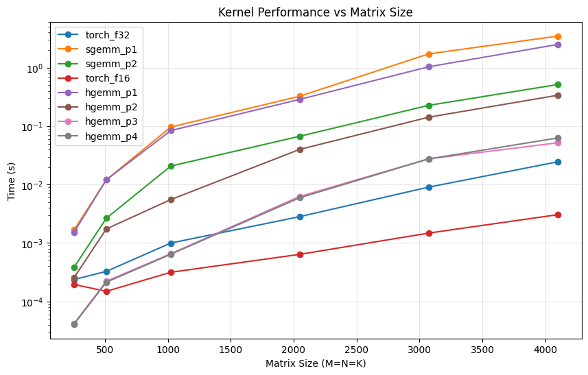

# CUDA GEMM Kernels for Transformer Inference

Matrix multiplication (GEMM) accounts for most of the compute in transformer
inference: the Q/K/V and output projections, the MLP layers, and the LM head.
This repo builds that operation from scratch as a PyTorch C++/CUDA extension,
going from a naive kernel to shared-memory tiling to TensorCores, and measures
each step for speed and numerical accuracy against PyTorch (cuBLAS) and a
float64 reference.

All kernels compute `C = A @ B.T`, with `A` of shape `M x K` and `B` of shape
`N x K`, the layout of a linear layer's weight matrix.

## Kernels

| Kernel | Precision | Approach |
|---|---|---|
| `sgemm_p1` / `hgemm_p1` | FP32 / FP16 | Naive: one thread per output element, reading A and B straight from global memory |
| `sgemm_p2` / `hgemm_p2` | FP32 / FP16 | Tiled: each 16x16 thread block stages tiles of A and B in shared memory |
| `hgemm_p3` | FP16 in, FP16 accumulate | TensorCores via WMMA: one warp per 16x16 output tile |
| `hgemm_p4` | FP16 in, FP32 accumulate | TensorCores via WMMA with mixed-precision accumulation |

**Naive (p1).** Each thread computes one dot product of length K. Neighboring
threads re-read the same rows and columns from global memory with no reuse,
so the kernel is memory-bound. The FP16 version uses the `__hfma` intrinsic.

**Tiled (p2).** A block of 256 threads cooperatively loads one 16x16 tile of A
and one of B into `__shared__` memory, synchronizes with `__syncthreads()`,
multiplies the tiles, synchronizes again, and moves along K. Each value loaded
from global memory is now reused 16 times from on-chip shared memory.

**TensorCore (p3).** A single warp loads 16x16 fragments with
`wmma::load_matrix_sync` and issues `wmma::mma_sync`, so the matrix
multiply-accumulate runs on dedicated TensorCore hardware. B is read as a
column-major `K x N` matrix directly from its `N x K` row-major storage, so no
transpose is materialized.

**Mixed precision (p4).** Same as p3, but the accumulator fragment is FP32 and
the output is FP32. Inputs stay FP16, so it keeps TensorCore throughput while
avoiding the rounding error that builds up when summing thousands of FP16
products.

## Results



- **Tiling is the first big win.** Shared-memory reuse makes p2 several times
  faster than p1 at every size, up to roughly an order of magnitude.
- **TensorCores are the second.** p3 and p4 run one to two orders of magnitude
  faster than the naive kernels.
- **cuBLAS still wins at scale.** The TensorCore kernels are competitive with
  `torch.mm` at small sizes, while cuBLAS pulls ahead as matrices grow (see
  below for why).
- **Accumulation precision matters more than input precision.** Accumulating
  in FP16 (p3) gives noticeably larger error against the float64 reference than
  accumulating in FP32 (p4), at essentially the same speed. This is the same
  trade-off that makes FP16/BF16 mixed-precision training and inference work.

## What cuBLAS does that these kernels don't

The gap to `torch.mm` at large sizes comes from optimizations these kernels
deliberately leave out:

- **Larger tiles and register blocking:** each thread or warp computes several
  output tiles, reusing fragments from registers instead of reloading them.
- **Shared-memory staging for TensorCores:** p3/p4 load fragments straight from
  global memory, so neighboring warps re-fetch the same data.
- **Double buffering:** loading the next tile asynchronously (e.g. `cp.async`
  on Ampere and newer) while computing on the current one hides memory latency.
- **Bank-conflict avoidance:** padding or swizzling shared-memory layouts.
- **Autotuning:** choosing tile shapes and kernel variants per problem size
  and GPU architecture.

These are the next steps for this project, roughly in order of expected payoff.

## Structure

- `kernels.cu`: CUDA kernel implementations
- `wrapper.cpp`: PyTorch C++ extension bindings (pybind11)
- `setup.py`: extension build configuration
- `benchmark.py`: correctness check (relative squared error vs. a float64
  reference) and a timing sweep across matrix sizes, with a log-scale plot

## Build and run

```bash
python3 setup.py build
python3 setup.py install
python3 benchmark.py
```

Requires an NVIDIA GPU with TensorCores (Volta or newer) for `hgemm_p3` and
`hgemm_p4`. A free Google Colab T4 runtime works.
